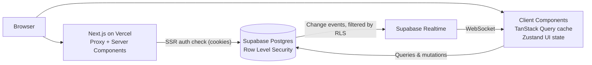

# TeamFlow


**A real-time collaborative Kanban board for small teams.**
Built with Next.js 16, TypeScript, Supabase, and TanStack Query.

🔗 **Live demo:** https://team-flow-collaborative-project-and.vercel.app/
👤 **Demo login:** `demo@teamflow-demo.com` / `TeamFlowDemo2025!`


---

## ✨ Features

- **Workspaces & roles:** create workspaces, invite teammates, admin/member permissions enforced by Postgres Row Level Security
- **Kanban boards:** five status columns with drag-and-drop for **mouse, touch, and keyboard**
- **Real-time sync:** see teammates move, create, and comment on tasks instantly
- **Optimistic UI:** moves and comments appear immediately and roll back on failure
- **Search & filters:** priority, status, assignee, due date, and sort, all persisted in the URL (shareable, refresh-safe)
- **Task details:** shareable task pages with comments
- **Polish:** dark mode without flash, loading skeletons, empty states, error boundaries, responsive layout

| Light                                                  | Dark                                                 | Mobile                                       |
| ------------------------------------------------------ | ---------------------------------------------------- | -------------------------------------------- |
|  |  |  |

## 🛠 Tech Stack

| Area        | Tools                                                             |
| ----------- | ----------------------------------------------------------------- |
| Framework   | Next.js 16 (App Router, Server Components, Server Actions, Proxy) |
| Language    | TypeScript (strict, types generated from the database schema)     |
| UI          | Tailwind CSS, shadcn/ui (Radix), lucide-react                     |
| Data        | Supabase (Postgres, Auth, Realtime), TanStack Query               |
| State       | TanStack Query for server state, Zustand for UI-only state        |
| Forms       | React Hook Form + Zod                                             |
| Drag & drop | dnd-kit                                                           |
| Testing     | Vitest, React Testing Library, Playwright                         |
| CI/CD       | GitHub Actions, Vercel                                            |

## 🏗 Architecture



- **Security lives in the database.** Every table has RLS policies backed by `SECURITY DEFINER` helper functions. The UI hides admin actions, but the database is what actually enforces them.
- **Server Components** handle auth checks and 404s. Interactive parts are small Client Components. The board (with dnd-kit) is **dynamically imported**, so it never ships to other pages.
- **Realtime events patch the TanStack Query cache.** Components read from one cache, with no duplicated state.

## 🧠 Key Technical Decisions

<details>
<summary><b>Fractional positioning for drag-and-drop</b></summary>

Tasks use `double precision` positions spaced 1000 apart. Dropping between two tasks takes the midpoint, so a move is **one row update**, never a renumbering of the column.

</details>

<details>
<summary><b>Optimistic updates that don't fight realtime</b></summary>

Moves update the cache instantly and roll back on error. Remote updates are **paused during a drag** and applied after the drop, `updated_at` comparisons ignore out-of-order events, and refetches only run when no other move is in flight, preventing flicker during rapid drags.

</details>

<details>
<summary><b>Filters in the URL</b></summary>

The URL is the single source of truth for filters. Updates use `history.replaceState` (no server round trip), and every URL param is validated against an allowlist, so `?status=<script>` falls back to defaults.

</details>

<details>
<summary><b>Accessible drag-and-drop</b></summary>

A dedicated drag handle keeps <kbd>Enter</kbd> free for opening tasks. A custom keyboard coordinate getter moves cards exactly one column per arrow key. Screen readers get live announcements, and the Status field offers a non-drag alternative (WCAG 2.5.7).

</details>

## 🧪 Testing

- **<95> unit & component tests** (Vitest + React Testing Library): filter logic, form validation, positioning, debounce hook, modal focus management. **<XX>% coverage** on core logic in `src/lib`.
- **<11> E2E tests** (Playwright): signup → workspace → board → task, keyboard drag-and-drop, multi-user invite + assign (verifies RLS with two browser contexts), URL filters, route protection.
- **CI** runs lint, typecheck, unit tests, and E2E on every push.

```bash
npm test            # unit & component tests
npm run test:e2e    # end-to-end tests
```


## 🚀 Run Locally

1. **Clone and install**
   ```bash
   git clone https://github.com/<YOUR_USERNAME>/teamflow.git
   cd teamflow
   npm install
   ```
2. **Create a Supabase project** at [supabase.com](https://supabase.com), then run [`supabase/schema.sql`](supabase/schema.sql) in the SQL Editor.
3. **Disable email confirmation** for local development: Authentication → Sign In / Providers → Email.
4. **Environment variables:** copy `.env.example` to `.env.local` and fill in your Supabase URL and anon key.
5. **Start**
   ```bash
   npm run dev
   ```

Requires Node.js 22+.

## ⚖️ Trade-offs & Future Work

- **Email confirmation is off** in the demo. Supabase's built-in email only delivers to project team members, so production use would need a custom SMTP provider. The signup flow already handles confirmation when enabled.
- **Invites add existing users only.** Token-based email invites for new users are a natural next step.
- **Client-side filtering** is instant for typical board sizes. Very large boards would move search to Postgres full-text search.
- **Concurrent edits** in the task form are last-write-wins. `updated_at`-based conflict detection would fix this.
- **Positions can get very close** after many drops in the same spot. A periodic rebalance would solve it.

## 📁 Project Structure

```
src/
├── app/            # Routes (App Router): landing, auth, /app dashboard
├── actions/        # Server Actions (auth, profile)
├── components/     # Feature folders: boards, tasks, comments, members, workspaces
├── hooks/          # TanStack Query hooks, realtime, debounce, filters
├── lib/            # Pure logic: filters, positions, validation, formatting
├── stores/         # Zustand UI state
└── types/          # Database types
e2e/                # Playwright tests
supabase/           # Database schema
```

---

Built by **Akash Gauda** · [LinkedIn]([link](https://www.linkedin.com/in/akashgauda16 )) · [Portfolio](link)
